# DAC (New) Arduino Uno R4 Hardware Install Guide

## Hardware assembly guide
This part serves as how to properly assemble the necessary parts.

## Step 0.
Refer to https://github.com/ma-quantumlab/DAC-New-Arduino-U4-Based/tree/main/Hardware

It requires 3 different customized PCB boards to be manufactured. You need to pick the corresponding GerBer file (used for manufacturing) and BOM file (used to purchase necessary parts). You can use a variety of factories like JLCPCB or OSHPark, and Digikey or Mouser to source the necessary files.

Note: For PCB manufacturing, no specific processing technology is needed. Generic FR-6 with lead-free coating is considered enough. Components can be sourced elsewhere, as long as they provide the same value and packaging.

Once everything is correctly assembled, you can process to the next step.

## Step 1.
Make sure you have set up all necessary hardware. Check your soldering and wiring, make sure no short circuits, and check if the insulations are properly installed. All the necessary electronic apparatus is shown below.
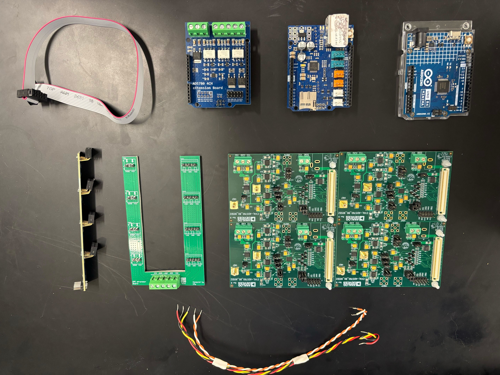\
The top four from left to right are 5*2 parallel cable, AD5780 4CH eXtension Board, Arduino Ethernet Shield, Arduino Uno R4.\
The bottom, from left to right, is DAC eXtension Signal Board, DAC eXtension Power Board, AD5780 * 4, and cables needed for wiring.

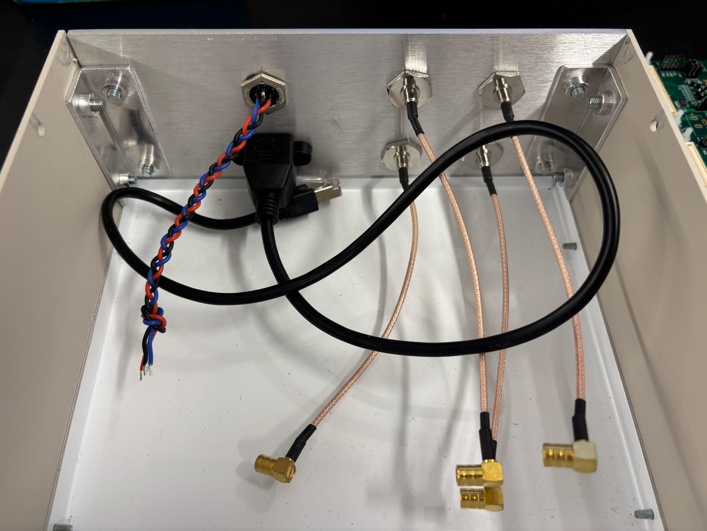\
The box assembly is shown in the above picture. It has 4 * BNC to SMB connectors used to connect to DAC, an Ethernet extension cord used to connect to Ethernet shield, and an aviation connector used to power-up the whole system.\
Note: For Ethernet shield, you may need to de-solder the old SPI headers first, then re-solder a new header with enough length of the pins.

**WARN: Check your aviation connector solder point, it has orientation and must match the following picture.**
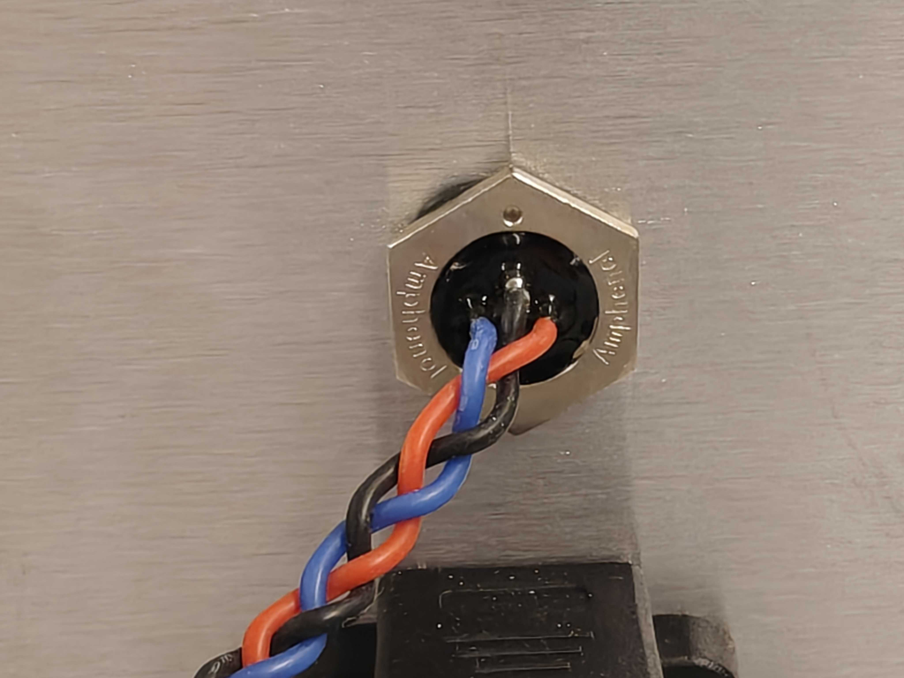
With the top pin points up and looking from the back, the LHS is VSS (blue, $-15V$), the MIDDLE is GND (black, $0V$), and the RHS is VDD (red, $+15V$).

## Step 2. 

Make sure the extension board and power board look like the following picture.
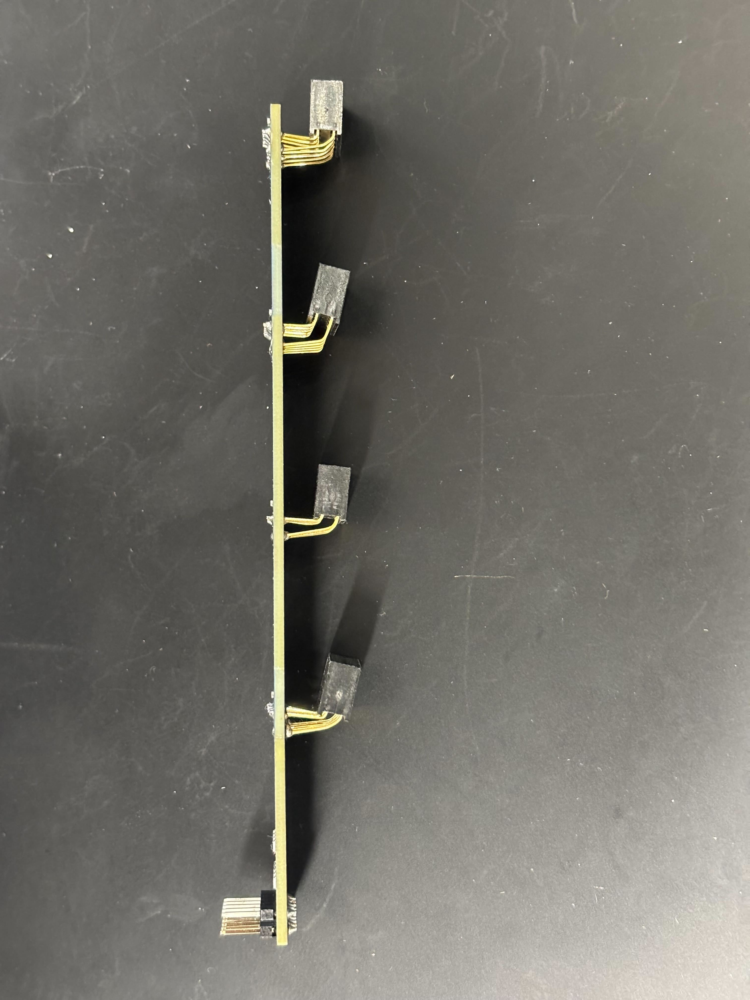\
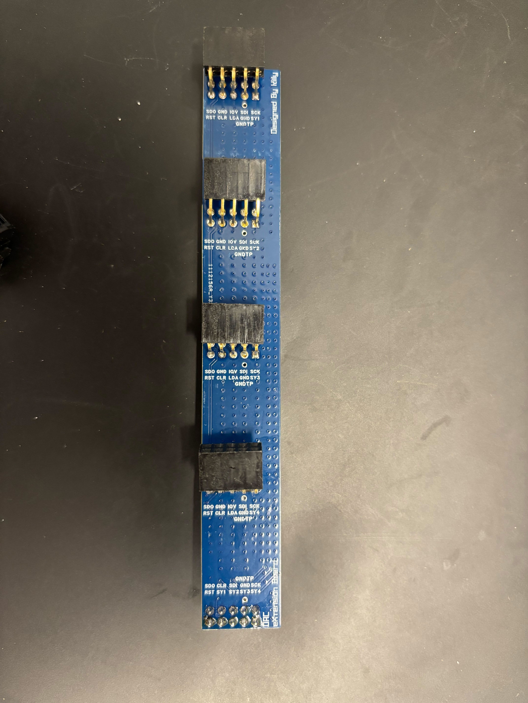\
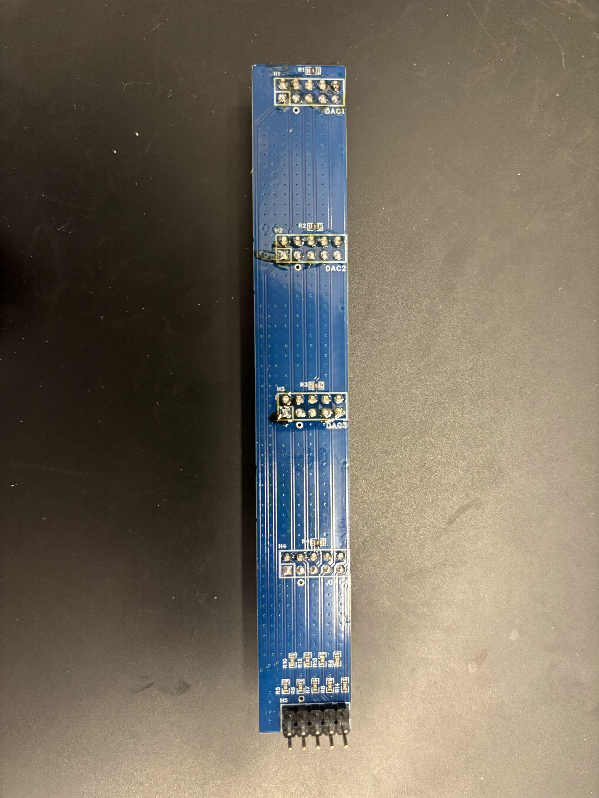\
The above picture shows how the signal board is assembled.

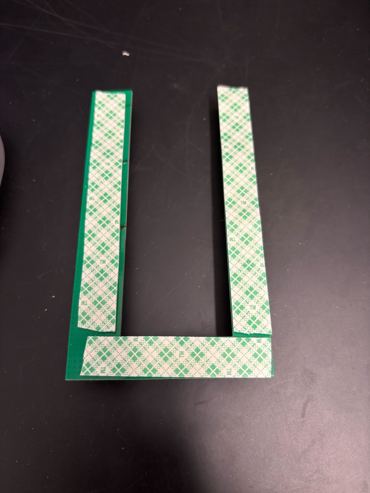\
The foam tape is acting as an insulation layer, preventing the solder joint from shorting on the metallic box.

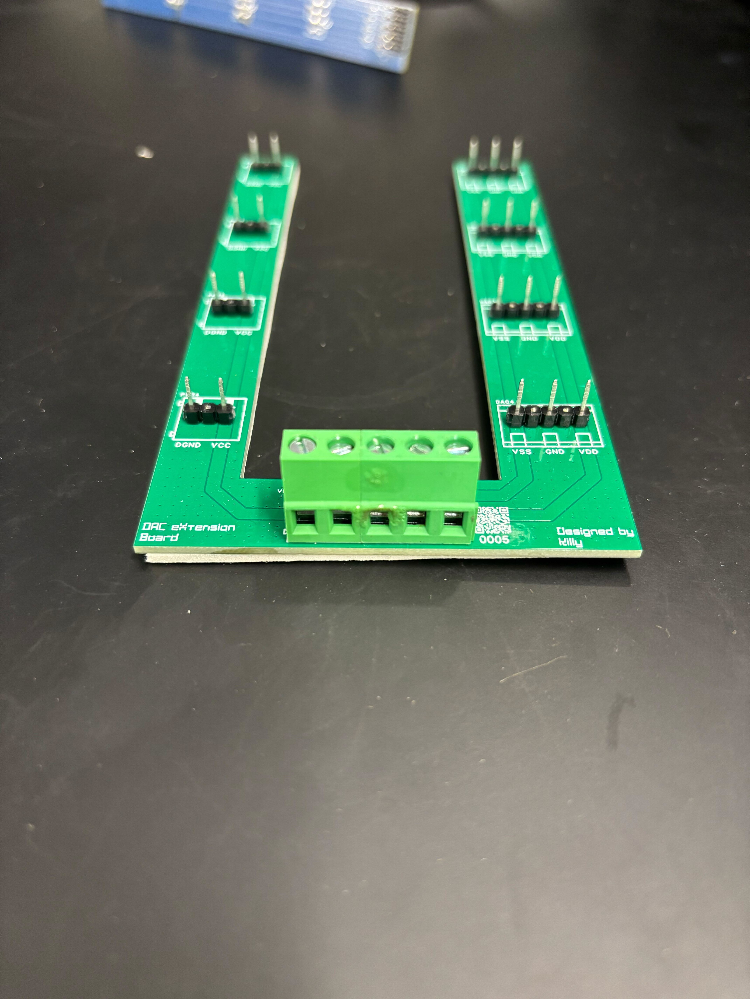\
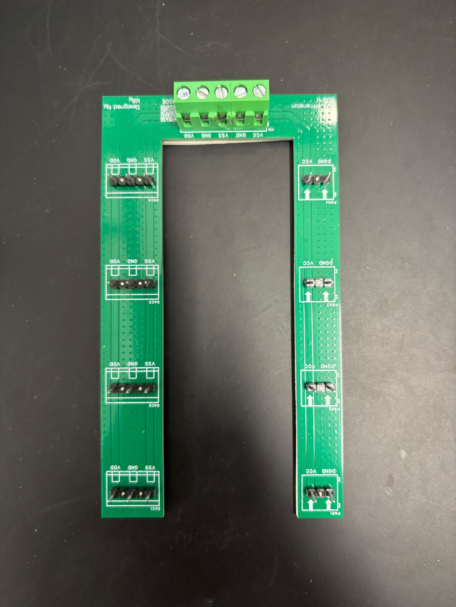\
**WARN: Direction matters! You must check the orientation of the headers and the solder to make sure they match exactly as the picture shows. Otherwise your DAC may be permanently damaged.**

## Step 2.
Connect the power board and the output cord to the DAC.
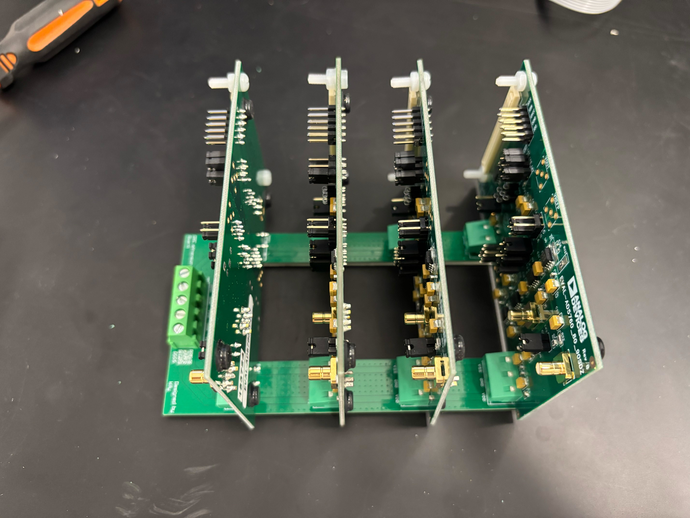\
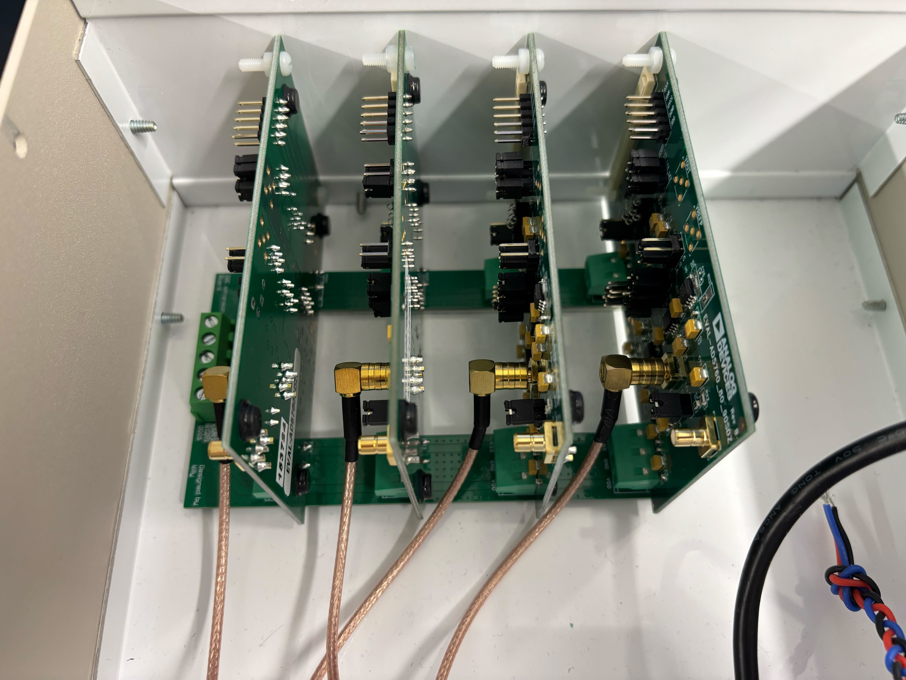


After that, wiring up all the necessary parts.\
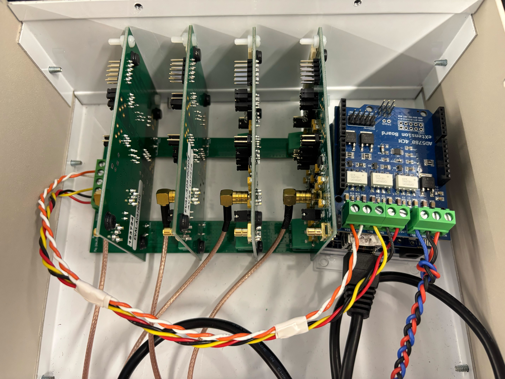
Remember to check the cable polarity before wiring. Corresponding polarity is labeled on the PCB board. They must match.


```python

```
