# DAC (New) Arduino Uno R4 Software Install Guide

## Open the configured project (recommended)

The repository now contains a root `platformio.ini` for the **Arduino Uno R4
Minima**. Open the **DAC Box repository root** in VS Code, install the recommended
PlatformIO IDE extension, and let its first-time setup finish. Reload the window
if prompted. There is no need to create a new project or copy source files.

The configuration uses the existing `Software/src` and `Software/lib` folders,
Renesas RA platform **1.9.0**, Arduino core **1.6.0**, compiler package
**1.70201.0**, DFU tool **1.11.0**, and a local recovery fork of Ethernet **2.0.2** in
`Software/lib/Ethernet`. PlatformIO installs these pinned packages automatically. Keep the
local Ethernet library: it supplies the physical-button cancellation/reset support. USB upload uses DFU, and
the serial monitor is set to **115200 baud**.

In the PlatformIO sidebar, select `uno_r4_minima` and use **Build**, **Upload**, or
**Monitor**. The equivalent commands in a PlatformIO Core terminal are:

```text
pio run -e uno_r4_minima
pio device list
pio run -e uno_r4_minima -t upload
pio device monitor -b 115200
```

Connect the selected Minima using a USB data cable before uploading. The DFU
upload target is pinned by USB serial; COM-port numbering is used for monitoring.
Close any serial monitor that is holding the port before upload. If automatic
bootloader entry fails, double-press the board's reset button and retry Upload.

Before building, create the ignored local configuration following
[Local bench configuration](../../config/README.md). The same file is used by
firmware, Python and the dashboard. Do not put real IP/MAC/USB identities into
source, `platformio.ini`, or tracked notebooks.

Select the named physical unit with `DAC_UNIT`, or use the Unit 1/Unit 2
convenience environments. A `_bench` build includes USB button emulation;
physical controls remain active in every build. Each box still uses local
channels 1–4 and TCP port 23. Global numbering comes only from the ordered list.

```powershell
$env:DAC_UNIT = 'unit2'
pio run -e uno_r4_minima_bench
pio run -e uno_r4_minima_bench -t upload
Remove-Item Env:DAC_UNIT
```

Verify the target USB serial in your local configuration before upload.
Renesas DFU ignores `--upload-port`; the post-build upload script selects the
configured USB serial. Missing configuration prevents upload. No source edit is
needed for the third or later unit. Keep measured calibration with its physical
box; a new box should use nominal entries until measured.

The initial configuration built successfully on 2026-10-13. The 2026-10-14
physical-control firmware also builds successfully; build success does not validate
physical DAC outputs. See [Physical controls](../Physical%20controls.md) for A1/A2
button wiring, 0.01 V/s zeroing, and recovery behavior. The full repair version
uses `RAMP ACCEPTED` plus `STATUS` polling; update Python callers with the helper
in `Software/python/dac_client.py` when uploading that version.

The older manual project-creation walkthrough is preserved below for reference.

## Software assembly guide
This part serves as how to properly install the necessary software.

## Step 0.

To properly set up the software, you need to install **VS Code** first. After that, install **Platform IO**. The installation guide for Platform IO can be found here. 

https://platformio.org/platformio-ide

Once everything is set up, you should see the following welcome page.\
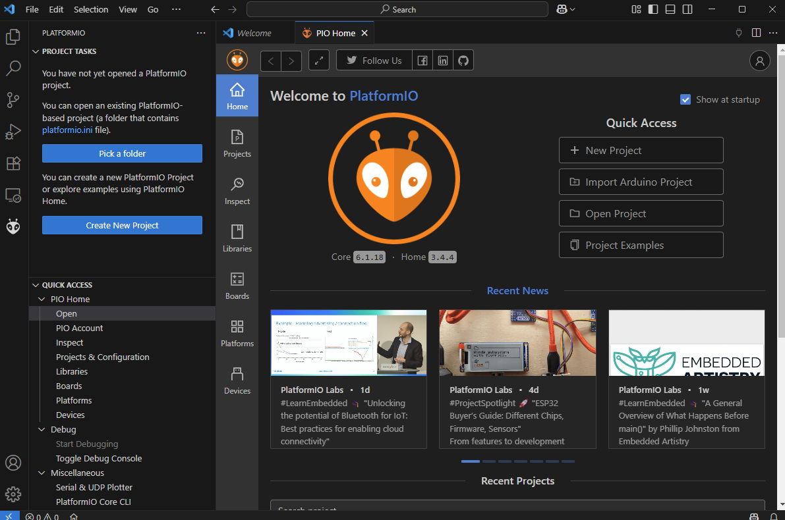

Please proceed to the next step after you see this.

## Step 1.
After that, click **New Project** and set up as the following picture.\
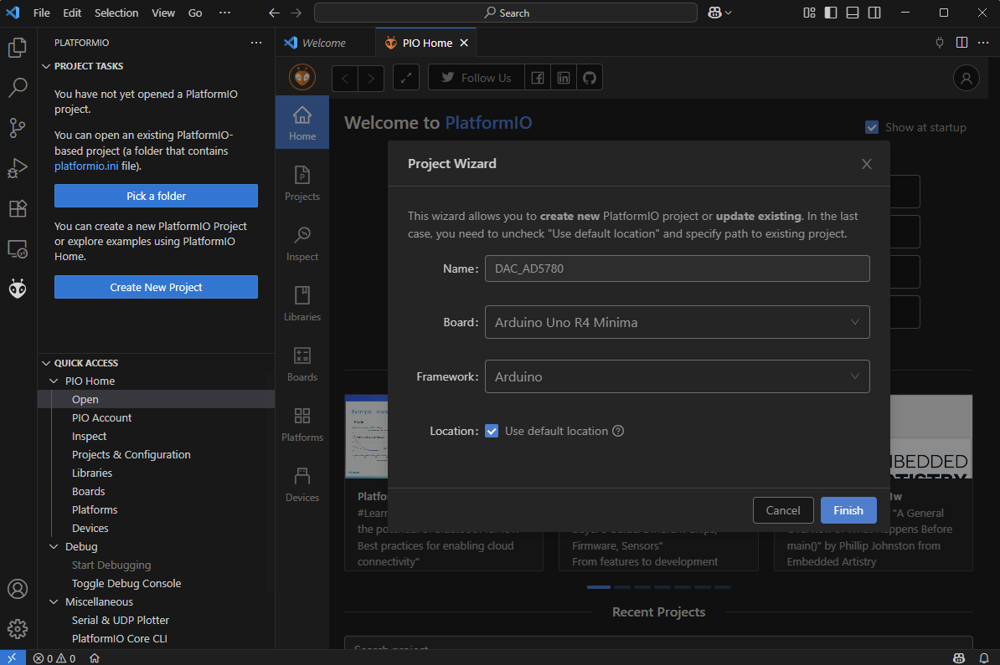\
Note: You can choose a different location if needed.
Note: The initial setup may take some time, as the system needs to download different packages and software. Please be patient.

After a while, you should automatically enter the main panel of the software, it should have a similar layout like the following picture.\
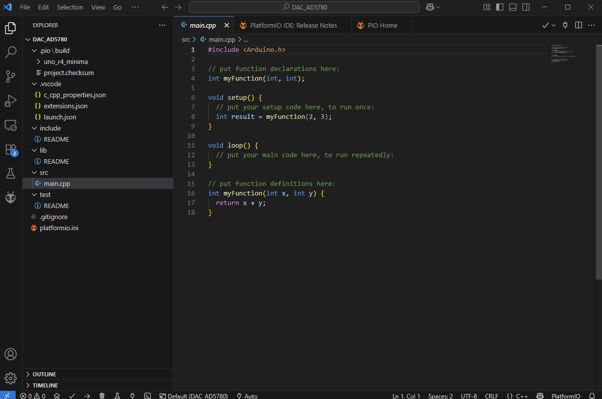

Please proceed once you have achieved the same settings.

## Step 2
Click the "home" button at the bottom left corner.\
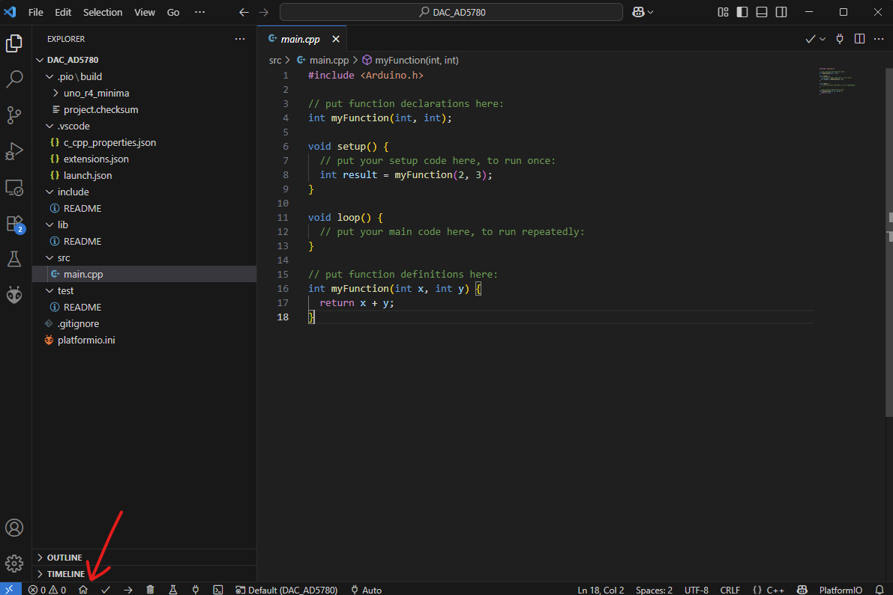

Once you open the main page, go to **Libraries** on the left, then search for **Ethernet**, you should locate a library titled ***Ethernet** by Various*, with roughly 40k downloads, and it is written by official Arduino developers, indicated on the top right.\
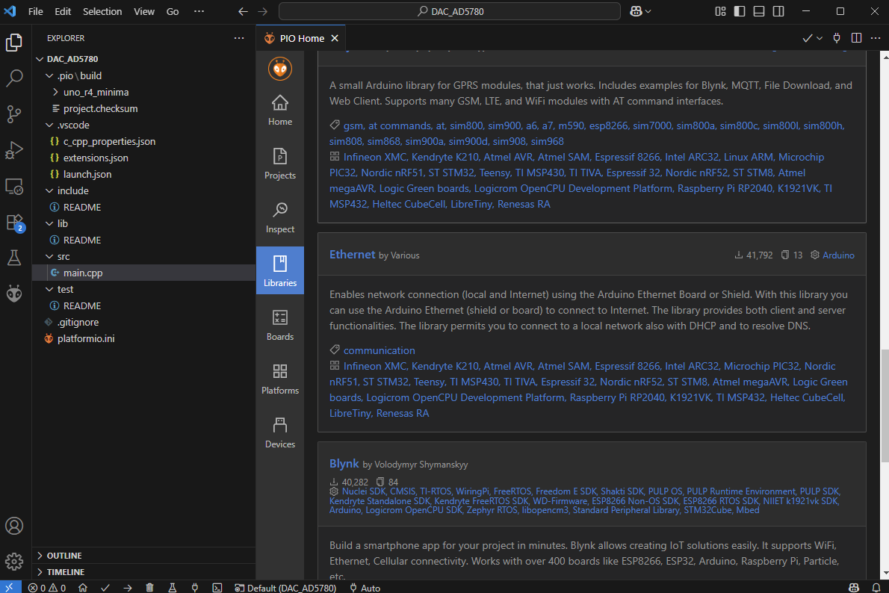

Click into it, click **Add to Project**, then select our project for DAC, then proceed.\
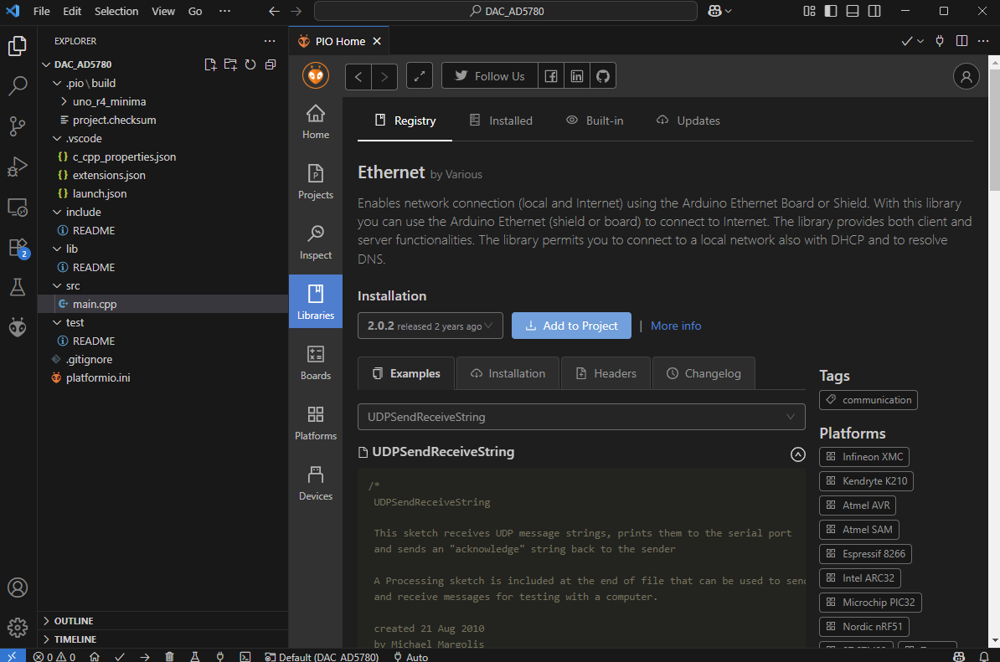\
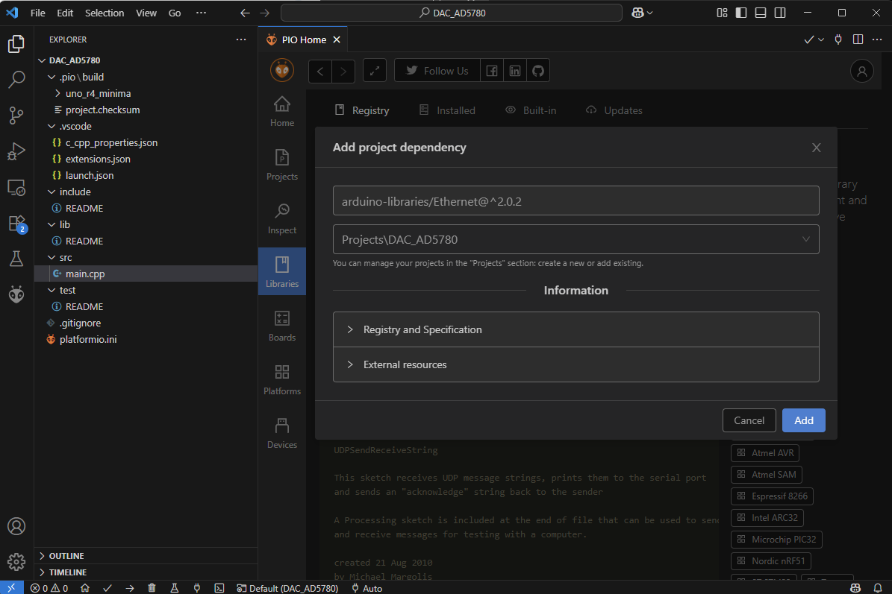

After that, you should be returned to the main page. Now, download the necessary programs from the GitHub repo or Dropbox, put them into the corresponding lib and src folder. Hit yes to replace existing files if needed.\
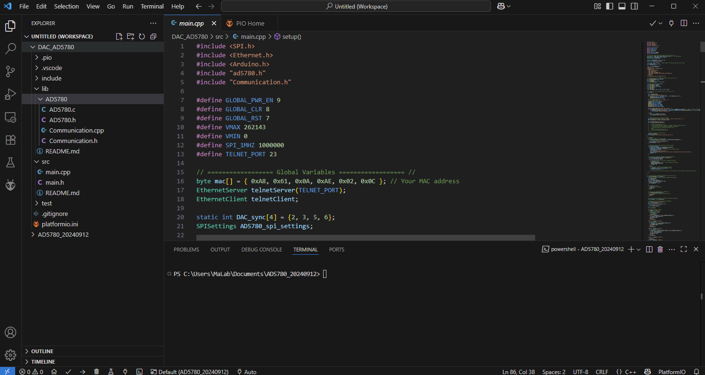

## Step 3.
To properly setup, you should change the mac address and the corresponding static IP address for your dac board. Locate and change the following lines in the main.cpp
```cpp
byte mac[] = { 0xAA, 0xBB, 0xCC, 0xDD, 0xEE, 0xFF }; // Change to your MAC address

Ethernet.begin(mac, IPAddress(192,0,2,123)); //Change to a valid static IP address.
```

If you have done everything mentioned above, you can click the compile button located at the bottom left to verify if everything works as expected.\
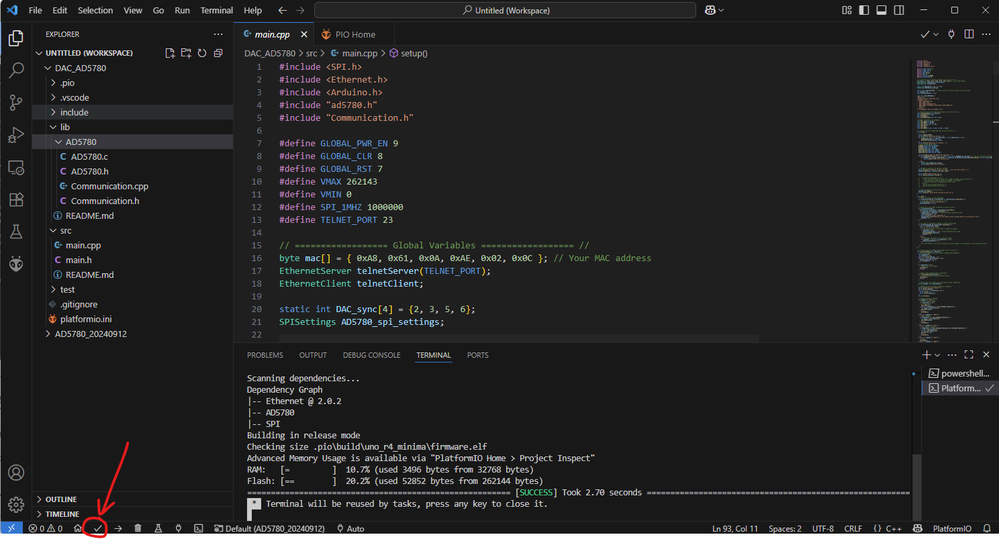

After confirming the compile is successful, you can proceed to plug in the board and upload your program to the Arduino Uno R4.\
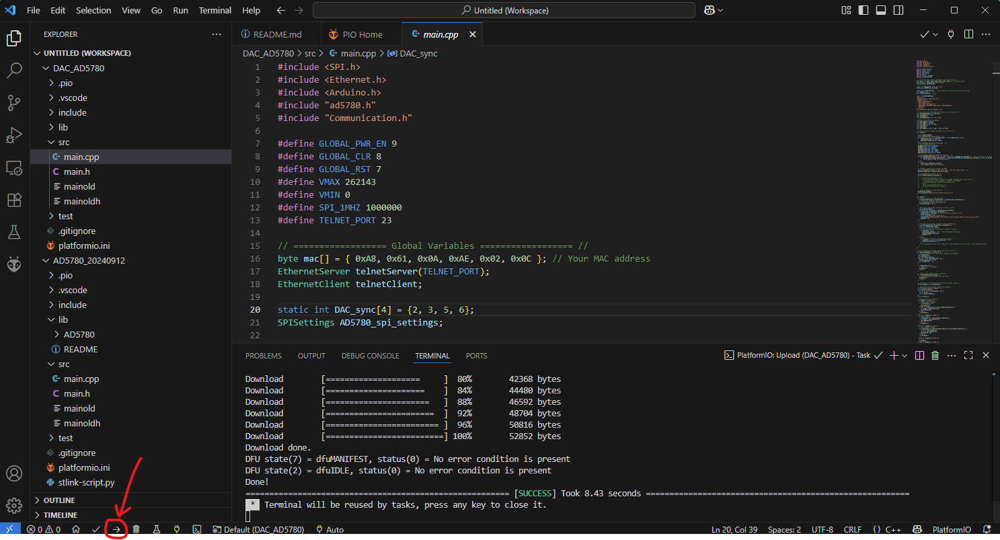\
After successful uploading, you can disconnect the dev board and proceed to the next step.

Note: You need to install the Arduino Uno R4 driver, so your computer can recognize the Arduino hardware. A screenshot is taken from the *USBTreeView* software
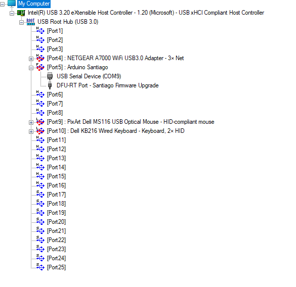

Detailed driver instructions can be found here.

https://docs.arduino.cc/tutorials/uno-r4-minima/minima-getting-started

https://www.arduino.cc/en/Guide/DriverInstallation
